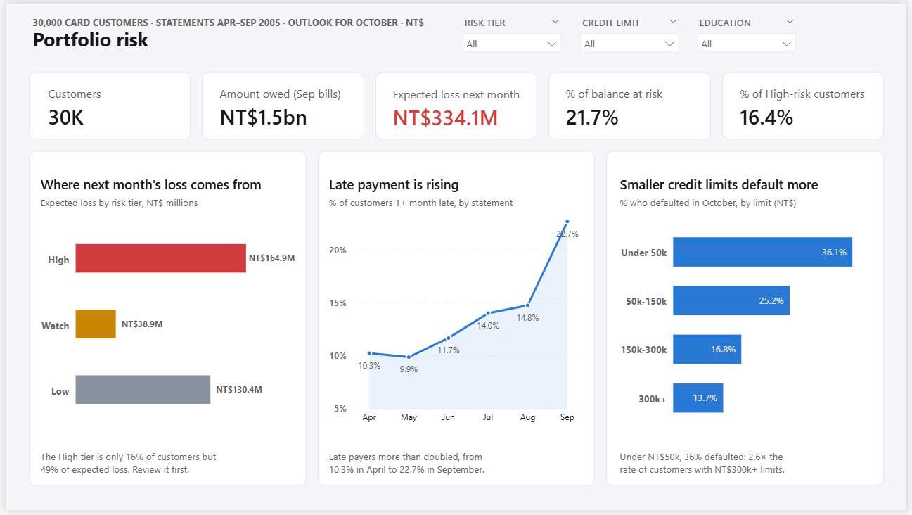
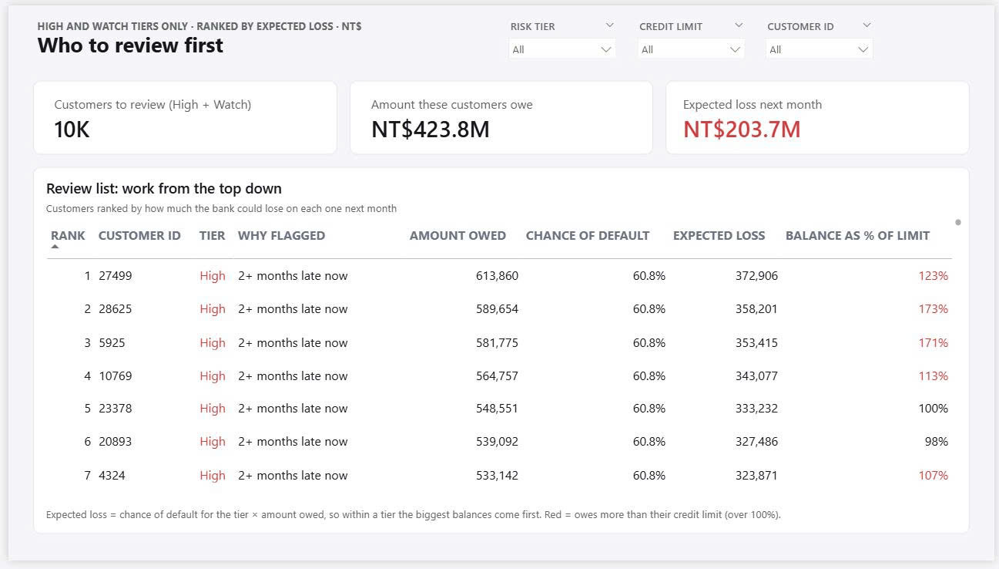
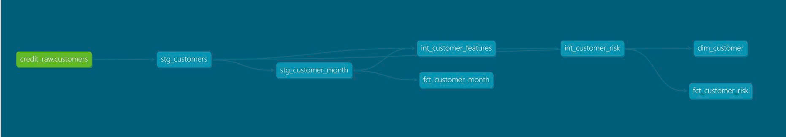

# Credit Card Risk Pipeline

An early-warning dashboard that tells a bank's credit risk team how much it could lose, whether risk is rising, and which customers to review first.

**Tools:** BigQuery · SQL · dbt · Power Query · Power BI



## What this project answers

A Taiwanese card issuer (2005, illustrative scenario) only found out about defaults after customers stopped paying. Acting as the consultant, I built a pipeline and dashboard that answer the Head of Credit Risk's three questions:

| Client question | Answer | Dashboard |
|---|---|---|
| How much could we lose next month? | **NT$334M** expected loss on NT$1.54B owed (21.7%) | Page 1 |
| Is late payment getting worse? | **Yes.** Late payers more than doubled, from 10% in April to 23% in September | Page 1 |
| Who should we review first? | **10,069 High and Watch customers** (NT$204M of expected loss), ranked so the biggest losses come first, each with the reason they were flagged | Page 2 |



## Key findings

- **Focus pays off:** the High-risk tier is 16% of customers but 49% of expected loss, and holds 45% of next month's defaulters.
- **Two months late is the tipping point:** these customers default at 69%, against 14% for customers who pay on time.
- **Small limits are riskiest:** 36% of customers with limits under NT$50k defaulted, against 14% at NT$300k and above.

## How it works

```
Raw CSV → BigQuery → dbt (clean → risk tiers → star schema) → Power BI
```

- **Data quality first:** 13 checks against DAMA's quality dimensions, each logged with a decision in [`docs/data_quality_log.md`](docs/data_quality_log.md).
- **dbt pipeline:** 7 models and 11 automated tests rebuild every table with one command, `dbt build`.
- **Dashboard:** Power BI reads the final dbt tables, so every number traces back to tested SQL. Power Query and DAX only format and add up; no risk logic lives in the report.



## How to use it

1. Install the requirements and sign in to Google Cloud:
   ```bash
   pip install -r requirements.txt
   gcloud auth application-default login
   ```
2. Build and test the pipeline:
   ```bash
   cd credit_dbt
   dbt build
   ```
3. Open `powerbi/credit_risk_monitor.pbix` and click **Refresh**.

The one-off stakeholder queries are in [`sql/`](sql/), and their answers are in [`docs/findings.md`](docs/findings.md).

**Data:** Yeh, I-C. (2009). *Default of credit card clients*. UCI Machine Learning Repository.
